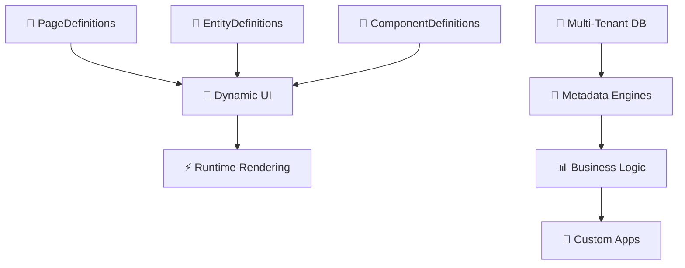

# 🚀 Metadata-Driven Platform

**A next-generation no-code/low-code application platform that powers unlimited custom applications through runtime metadata.**

[](https://github.com/your-org/metadata-erp)
[](https://github.com/your-org/metadata-erp)
[](https://github.com/your-org/metadata-erp)
[](https://github.com/your-org/metadata-erp)

---

## 🎯 **What Is This?**

This is a **WordPress-inspired application platform** that can spawn unlimited custom applications (CRM, ERP, Project Management, E-commerce, etc.) without writing code. Everything is driven by metadata stored in database tables.

### **🌟 Key Capabilities:**

- 📋 **Dynamic Applications** - Build any app (CRM, ERP, etc.) through metadata
- 🧩 **Component Catalog** - WordPress-style plugin/widget system
- 🏢 **Multi-Tenant SAAS** - Separate databases per company
- 🌍 **Multilingual** - English + Greek with database translations
- 🎨 **Multi-Theme** - Light/Dark themes via CSS custom properties
- 🔐 **Enterprise Auth** - JWT + 2FA + Magic Links + RBAC
- 🤖 **AI-Powered** - Built-in AI assistants and insights
- 📊 **Compliance Ready** - Greek tax/business compliance built-in

---

## 🏗️ **Architecture**

### **Metadata-First Design**

Everything is defined in database tables and rendered at runtime:



### **🔧 Technology Stack**

| **Layer**      | **Technology**           | **Purpose**                      |
| -------------- | ------------------------ | -------------------------------- |
| **Frontend**   | Next.js 15+ + TypeScript | 6 specialized web applications   |
| **Backend**    | FastAPI + Python 3.11+   | 6 microservices + 2 AI services  |
| **Database**   | PostgreSQL 17+           | Master DB + per-tenant databases |
| **Caching**    | Redis 7.2+               | Metadata caching + sessions      |
| **Auth**       | JWT + Refresh Tokens     | Multi-factor authentication      |
| **Styling**    | Tailwind CSS + shadcn/ui | Metadata-driven themes           |
| **Deployment** | Docker + Docker Compose  | Container orchestration          |

---

## 📁 **Project Structure**

```
metadata-erp/
├── 🌐 apps/                    # 6 Next.js Applications (to be implemented)
│   ├── client/                 # Main client application (CRM/ERP interface)
│   ├── admin/                  # Admin dashboard
│   ├── marketing/              # Marketing website (public)
│   ├── setup/                  # Data migration tool
│   ├── staff-support/          # Admin support interface
│   └── user-support/           # Customer support portal
├── 🔧 services/                # Backend Services (implemented)
│   ├── api/                    # Core metadata API ✅
│   ├── auth/                   # Authentication service ✅
│   ├── files/                  # File management
│   └── integrations/           # External integrations
├── 📦 packages/                # Shared Libraries
│   ├── shared/                 # Shared components & utilities ✅
│   │   ├── ui/                 # React component library
│   │   ├── api/                # API client
│   │   ├── auth/               # Auth utilities
│   │   ├── utils/              # Common utilities
│   │   ├── ai/                 # AI integration
│   │   ├── voice/              # Voice services
│   │   └── dynamic-entities/   # Dynamic entity management
│   ├── shared-assets/          # Static assets ✅
│   └── ai-services/            # AI microservices
├── 📋 scripts/                 # Automation Scripts ✅
│   ├── create-fresh-db.ps1     # Database setup
│   └── test-metadata-system.ps1 # Full system test
├── 📚 docs/                    # Documentation ✅
│   └── greek-compliance/       # Greek business compliance
├── 🔍 old_stuff/               # Reference Implementations
│   ├── dashboard/              # Legacy dashboard (for adaptation)
│   ├── login/                  # Legacy login (for adaptation)
│   └── migrations/             # Custom migration system
├── 🐳 docker-compose.yml       # Service orchestration ✅
├── 📋 PROJECT_RULES.md         # Architecture guidelines ✅
└── 📖 README.md                # This file ✅
```

---

## 🚀 **Quick Start**

### **Prerequisites**

- Docker & Docker Compose
- Python 3.11+
- Node.js 20+
- PowerShell (Windows) or Bash (Linux)

### **🏗️ Setup Fresh Database**

```powershell
# Start database services and create fresh database
./scripts/create-fresh-db.ps1
```

### **🔧 Start Services**

```powershell
# Start all services
docker-compose up -d

# Or start specific services:
cd services/api && python main.py     # Core API (port 8000)
cd services/auth && python main.py    # Auth service (port 8001)
```

### **🌐 Start Frontend Apps**

```bash
# Start all frontend apps (ports 3000-3005)
npm run dev

# Or start specific apps:
npm run dev:client        # Main client (port 3000)
npm run dev:admin         # Admin dashboard (port 3001)
```

### **✅ Verify Setup**

```bash
# Test metadata API
curl http://localhost:8000/api/metadata/pages/login

# Test authentication
curl http://localhost:8001/auth/health
```

---

## 🎯 **Core Concepts**

### **🧠 Metadata-Driven Everything**

Instead of hardcoding application structure, everything is defined in database tables:

```typescript
// ❌ Traditional Approach
const LoginPage = () => (
  <form>
    <input type="email" placeholder="Email" />
    <input type="password" placeholder="Password" />
    <button>Login</button>
  </form>
);

// ✅ Metadata-Driven Approach
const DynamicPage = ({ pageRoute }) => {
  const pageDefinition = useMetadata(`/pages/${pageRoute}`);
  return <MetadataRenderer definition={pageDefinition} />;
};
```

### **🏢 Multi-Tenant Architecture**

Each company gets its own database with metadata inheritance:

```sql
-- Global metadata (shared by all tenants)
INSERT INTO entity_definitions (tenant_id, name, fields)
VALUES (NULL, 'Contact', '[{"name":"email","type":"string"}]');

-- Tenant-specific override
INSERT INTO entity_definitions (tenant_id, name, fields)
VALUES ('company-123', 'Contact', '[{"name":"email"},{"name":"vat_number"}]');
```

### **🧩 Component Catalog**

WordPress-style component system:

```json
{
  "componentId": "kanban-board",
  "name": "KanbanBoard",
  "type": "dashboardWidget",
  "module": "project-management",
  "propsSchema": {
    "type": "object",
    "properties": {
      "projectId": { "type": "string" },
      "showArchived": { "type": "boolean", "default": false }
    }
  }
}
```

---

## 🔐 **Authentication & Security**

### **🎫 Supported Auth Methods**

- 📧 **Email/Password** - Traditional authentication
- ✨ **Magic Links** - Passwordless authentication
- 🔐 **2FA/TOTP** - Google Authenticator, Authy, etc.
- 🔒 **Single Session** - One user, one active session

### **🛡️ Security Features**

- JWT with refresh tokens (15min/7day)
- Row-level security for tenant isolation
- Field-level permissions from metadata
- Complete audit logging
- Rate limiting on auth endpoints

### **👥 Default Accounts**

```
🏢 Company: Development Corp (dev.local)
🔑 Admin:   admin@dev.local / 
🔑 Demo:    demo@dev.local / demo123!
```

---

## 📊 **Database Schema**

### **🗄️ Database Strategy**

- **Master Database** - Global metadata, users, components
- **Per-Tenant Databases** - Company-specific data and metadata overrides
- **28 Core Tables** - Metadata, auth, platform engines

### **🔑 Key Tables**

```sql
-- Metadata Foundation
entity_definitions     -- Business objects (Contact, Project, etc.)
field_definitions      -- Fields for each entity
layout_definitions     -- UI layout metadata
page_definitions       -- Page structure and routing

-- Component System
component_definitions  -- UI component catalog
module_manifests       -- Module packaging metadata

-- Platform Engines
workflow_definitions   -- Business process automation
billing_plans          -- Payment and subscription metadata
tax_jurisdictions      -- Country-specific tax rules
```

---

## 🛠️ **Development**

### **🎯 Core Principles**

1. **Metadata-First** - All business logic configurable via database
2. **Keep It Simple** - Choose simplest solution that works
3. **Plan First** - Design metadata structure before coding
4. **Tenant Isolation** - Complete separation between companies
5. **Component Thinking** - Build reusable, catalogued components

### **🔧 Development Workflow**

```bash
# 1. Create fresh database
./scripts/create-fresh-db.ps1

# 2. Start services in development mode
npm run dev:all

# 3. Test the complete system
./scripts/test-metadata-system.ps1

# 4. Make changes and iterate
```

### **📝 Code Standards**

- **Frontend**: Next.js 15+ App Router, TypeScript, Tailwind CSS
- **Backend**: FastAPI async, Pydantic validation, structured logging
- **Database**: PostgreSQL with async SQLAlchemy 2.0+
- **Security**: JWT auth, RBAC, tenant isolation

---

## 🧪 **Testing**

### **🎯 Automated Testing**

```powershell
# Complete system test (database + services + API tests)
./scripts/test-metadata-system.ps1

# Individual service tests
cd services/api && python -m pytest
cd services/auth && python -m pytest
```

### **🌐 Manual Testing**

```bash
# Metadata API endpoints
GET /api/metadata/pages/login          # Login page definition
GET /api/metadata/entities/Contact     # Contact entity metadata
GET /api/metadata/components/Input     # Input component definition

# Authentication endpoints
POST /auth/login                       # Email/password login
POST /auth/magic-link                  # Request magic link
POST /auth/refresh                     # Refresh access token
```

---

## 🚀 **Deployment**

### **🎯 Deployment Strategies**

- **Canary Deployment** - Core platform (5% → 20% → 80% → 100%)
- **Blue/Green** - Critical services (AADE, payments, auth)
- **Feature Flags** - Multi-level control (global, tier, customer, user)
- **Rolling Updates** - Support platform microservices
- **Customer-Specific** - Enterprise custom implementations

### **🐳 Production Setup**

```bash
# Production environment
docker-compose -f docker-compose.prod.yml up -d

# Scale services based on load
docker-compose up -d --scale api=3 --scale auth=2
```

---

## 📚 **Documentation**

### **📋 Core Documentation**

- [`PROJECT_RULES.md`](./PROJECT_RULES.md) - Architecture guidelines and standards
- [`CHANGELOG.md`](./CHANGELOG.md) - Development progress tracking
- [`docs/greek-compliance/`](./docs/greek-compliance/) - Greek business compliance specifications

### **🔧 Technical References**

- [Database Schema](./docs/database-schema.md) - Complete database documentation
- [API Documentation](./docs/api-reference.md) - REST API endpoints
- [Component Catalog](./docs/component-catalog.md) - Available UI components
- [Deployment Guide](./docs/deployment.md) - Production deployment instructions

---

## 🤝 **Contributing**

### **📝 Development Rules**

1. Read [`PROJECT_RULES.md`](./PROJECT_RULES.md) thoroughly
2. Follow "Plan First" - show approach before coding
3. Use metadata-driven patterns for all features
4. Maintain tenant isolation in all code
5. Add comprehensive tests for new features

### **🔄 Development Process**

```bash
# 1. Create feature branch
git checkout -b feature/new-component

# 2. Update metadata schema if needed
# 3. Implement backend changes
# 4. Add frontend metadata-driven rendering
# 5. Test with fresh database
# 6. Update documentation
# 7. Submit pull request
```

---

## 🏆 **Unique Features**

### **✨ What Makes This Special**

- 🧠 **AI-Powered Assistants** - Built-in AI for insights and automation
- 🧩 **Composable App Builder** - WordPress-style component marketplace
- 🏢 **Digital Twin Dashboards** - Industry-specific verticalized views
- 🏪 **Creator Economy** - Built-in marketplace for components and modules
- 🔗 **Data Mesh** - Cross-tenant benchmarking and analytics
- 🔒 **Privacy-First** - Compliance by design (GDPR, Greek regulations)

### **🇬🇷 Greek Market Focus**

- ✅ AADE integration for tax compliance
- ✅ Greek VAT system implementation
- ✅ Banking integration (NBG, Alpha, etc.)
- ✅ Greek address and postal code validation
- ✅ DOY (Tax Office) integration
- ✅ Multilingual Greek/English support

---

## 📞 **Support**

### **🐛 Issues & Bugs**

- Create an issue in the project repository
- Include steps to reproduce and expected behavior
- Attach relevant logs and configuration

### **💬 Discussion**

- Architecture decisions and technical questions
- Feature requests and enhancements
- Best practices and implementation guidance

---

## 📅 **Roadmap**

### **🎯 Current Phase: Foundation (Q4 2024)**

- ✅ Metadata-driven architecture
- ✅ Authentication system
- ✅ Database schema and engines
- 🔄 Frontend integration (in progress)

### **📋 Next Phase: Core Features (Q1 2025)**

- 🔲 Complete UI/Workflow engines
- 🔲 Component marketplace
- 🔲 Basic CRM/ERP applications
- 🔲 Greek compliance features

### **🚀 Future Phases**

- 🔲 AI assistants and automation
- 🔲 Advanced workflow engine
- 🔲 Marketplace creator tools
- 🔲 Enterprise deployment options

---

**Built with ❤️ for the future of no-code platforms**

_Last Updated: July 24, 2025 | Version 1.1.0_
