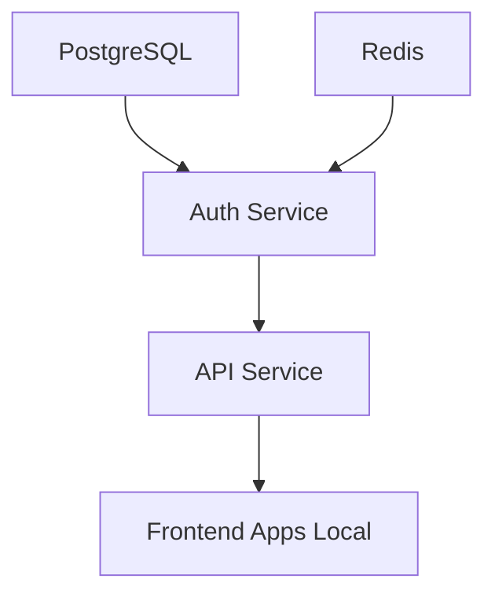

# 🐳 Docker Setup Guide - Metadata ERP Platform

**Hybrid development environment: Backend in Docker + Frontend locally**

> **Benefits**: Fast frontend development with reliable backend infrastructure  
> **Backend**: PostgreSQL + Redis + Auth + API in Docker containers  
> **Frontend**: Next.js apps run locally for hot reload and faster iteration  
> **Control**: Manual startup - no auto-restart conflicts

---

## 🚀 **Quick Start (Recommended)**

### **1. Morning Startup Routine**

```powershell
# Fresh start (recommended daily)
npm run morning

# Or quick start (if Docker is clean)
npm run start
```

### **2. Start Frontend Development**

```powershell
# Legal app (primary development)
npm run dev:legal

# Client app (if needed)
npm run dev:client

# Watch shared components (if editing shared UI)
npm run watch:shared-ui
```

### **3. Access Your Services**

- **🌐 Legal App**: http://localhost:3006 (local Next.js)
- **🌐 Client App**: http://localhost:3000 (local Next.js)
- **🔐 Auth Service**: http://localhost:8001 (Docker)
- **📡 API Service**: http://localhost:8000 (Docker)
- **🗄️ PostgreSQL**: localhost:5432 (Docker)
- **🔴 Redis**: localhost:6379 (Docker)

### **4. Test Login**

Use the imported admin account:

- **Email**: `admin@demo-eshop-crm.local`
- **Password**: ``

---

## 🔧 **Available Commands**

### **Daily Development**

```powershell
# Morning startup (full reset)
npm run morning           # ☀️ Fresh start complete!

# Quick backend start
npm run start            # 🚀 Backend services started!

# Frontend development
npm run dev:legal        # Legal app on port 3006
npm run dev:client       # Client app on port 3000
npm run watch:shared-ui  # Shared components watch mode
```

### **Docker Backend Management**

```powershell
# Basic operations
npm run docker:up        # Start backend services
npm run docker:down      # Stop all services
npm run docker:restart   # Restart all services
npm run docker:status    # Check service health

# Logs and debugging
npm run docker:logs      # All service logs
npm run docker:logs:api  # API service only
npm run docker:logs:auth # Auth service only
npm run docker:logs:db   # Database logs

# Maintenance
npm run docker:reset     # Complete reset (lose data)
npm run docker:clean     # Clean unused resources
```

---

## 📊 **Architecture Overview**

### **🐳 Docker Backend Services**

#### **🗄️ PostgreSQL Database**

- **Container**: `metadata-erp-postgres`
- **Port**: 5432
- **Database**: `metadata_erp`
- **Data**: Imported from working laptop setup
- **Persistence**: Volume mounted for data retention

#### **🔴 Redis Cache**

- **Container**: `metadata-erp-redis`
- **Port**: 6379
- **Usage**: Session storage, metadata caching
- **Persistence**: Volume mounted

#### **🔐 Auth Service**

- **Container**: `metadata-erp-auth`
- **Port**: 8001
- **Features**: JWT tokens, RBAC, session management
- **Health Check**: http://localhost:8001/health

#### **📡 API Service**

- **Container**: `metadata-erp-api`
- **Port**: 8000
- **Features**: Metadata engines, business logic
- **Health Check**: http://localhost:8000/health
- **Seeding**: Disabled (uses imported data)

### **💻 Local Frontend Development**

#### **🌐 Legal App (Primary)**

- **Command**: `npm run dev:legal`
- **Port**: 3006
- **Features**: Legal practice management UI
- **Hot Reload**: Instant updates on file changes

#### **🌐 Client App**

- **Command**: `npm run dev:client`
- **Port**: 3000
- **Features**: General client interface
- **Hot Reload**: Instant updates on file changes

#### **🔧 Shared Components**

- **Command**: `npm run watch:shared-ui`
- **Purpose**: Compile shared components on changes
- **Required**: When editing components in `packages/shared/ui`

---

## 🔄 **Service Dependencies & Startup Order**

The Docker Compose configuration ensures proper startup order:



1. **Infrastructure**: PostgreSQL + Redis start first
2. **Auth Service**: Waits for DB + Redis to be healthy
3. **API Service**: Waits for DB + Redis + Auth to be healthy
4. **Frontend**: Connects to healthy backend services

---

## 🌱 **Database Content**

### **Imported Data**

Your Docker database contains a complete working dataset imported from your laptop:

- **✅ Users**: Admin and business users with proper authentication
- **✅ Tenants**: Demo legal practice tenant configuration
- **✅ Roles & Permissions**: Complete RBAC setup
- **✅ Legal Metadata**: Entities, pages, layouts, components
- **✅ Business Data**: Sample clients, matters, time entries

### **No Auto-Seeding**

- **Auto-seeding disabled** to prevent conflicts with imported data
- Database preserves your working setup exactly
- Consistent data across laptop and desktop

---

## 🔍 **Troubleshooting**

### **🚨 Common Issues**

#### **Auth Service Shows "Unhealthy"**

```powershell
# Check networking issues
npm run docker:down
npm run docker:up

# Check logs
npm run docker:logs:auth
```

#### **Frontend Can't Connect to Backend**

```powershell
# Verify backend is healthy
npm run docker:status

# Check all services are up
docker-compose ps
```

#### **Port Conflicts**

```powershell
# Find what's using the port
netstat -ano | findstr :8001

# Kill the process (if safe)
taskkill /PID <PID_NUMBER> /F
```

### **🛠️ Manual Diagnostics**

#### **Database Connection Test**

```powershell
# Connect to database
docker exec -it metadata-erp-postgres psql -U postgres -d metadata_erp

# Check tables exist
\dt

# Check user data
SELECT email FROM users LIMIT 5;
```

#### **Auth Service Test**

```powershell
# Test health endpoint
curl http://localhost:8001/health

# Test login endpoint (PowerShell)
Invoke-RestMethod -Uri "http://localhost:8001/auth/login/password" -Method Post -Headers @{"Content-Type"="application/json"} -Body '{"tenant_id": "89f84fea-b5b9-413c-945b-002c7fd9555d", "email": "admin@demo-eshop-crm.local", "password": "", "device_name": "Test"}'
```

---

## 🔧 **Development Workflow**

### **Daily Routine**

```powershell
# 1. Start your day
npm run morning

# 2. Begin development
npm run dev:legal

# 3. If editing shared components
npm run watch:shared-ui
```

### **During Development**

- **Frontend changes**: Automatic hot reload
- **Backend code changes**: Services auto-restart (volume mounted)
- **Database changes**: Persist automatically
- **Shared component changes**: Rebuild with watch mode

### **Debugging**

```powershell
# Backend issues
npm run docker:logs:api
npm run docker:logs:auth

# Frontend issues
# Check terminal where dev:legal is running

# Database issues
npm run docker:logs:db
```

---

## 🎯 **Key Benefits of This Setup**

### **✅ Advantages**

1. **Fast Frontend Development**: Local Next.js with instant hot reload
2. **Reliable Backend**: Consistent Docker environment
3. **No Auto-Start Issues**: Manual control prevents conflicts
4. **Data Persistence**: Database survives restarts
5. **Easy Debugging**: Clear separation of concerns
6. **Production-Ready**: Same Docker backend for deployment

### **🔄 Comparison to Full Docker**

| Aspect            | Hybrid (Current) | Full Docker      |
| ----------------- | ---------------- | ---------------- |
| Frontend Speed    | ⚡ Instant       | 🐌 Slower builds |
| Backend Stability | ✅ Reliable      | ✅ Reliable      |
| Startup Control   | 🎯 Manual        | 🔄 Auto-restart  |
| Development UX    | 🚀 Excellent     | 😐 Good          |
| Port Conflicts    | ❌ Rare          | ⚠️ Common        |

---

## 🚀 **Next Steps**

With your hybrid environment running:

1. **✅ Login**: Test authentication at http://localhost:3006
2. **🔧 Layout Fixes**: Continue your metadata layout work
3. **🎨 Component Development**: Edit shared components with hot reload
4. **📊 Data Analysis**: Explore imported legal practice data

---

## 📋 **Production Deployment**

For production, you can use the same Docker backend:

```bash
# Production docker-compose.prod.yml
# - Add HTTPS/TLS certificates
# - Use production environment variables
# - Build optimized frontend containers
# - Configure proper scaling
```

Your development setup now provides the perfect balance of speed and reliability! 🎉
