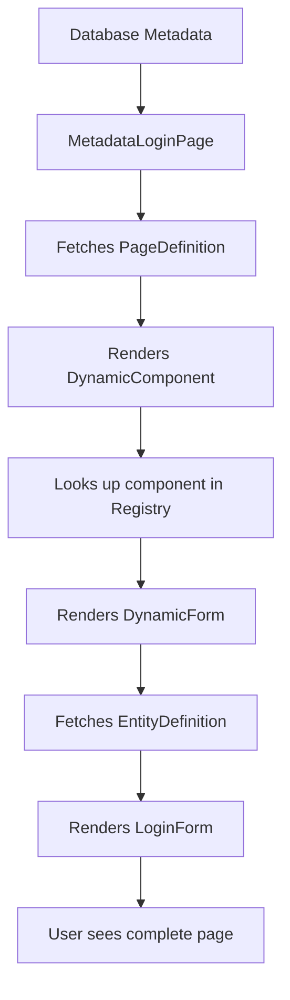

## 📋 **METADATA-DRIVEN FRONTEND ARCHITECTURE EXPLAINED**

These 3 files are the **core building blocks** of our metadata-driven frontend system. Let me explain how they work together:

---

## 🧩 **1. DynamicComponent.tsx - Component Registry & Renderer**

### **Purpose:**

This is the **"component factory"** - it maps metadata component types to actual React components and renders them dynamically.

### **How It Works:**

```typescript
// Component Registry - Maps strings to React components
const COMPONENT_REGISTRY = {
  Input: Input,           // "Input" → <Input />
  Button: Button,         // "Button" → <Button />
  Form: DynamicForm,      // "Form" → <DynamicForm />
  ThemeSelector: ThemeSelector,
  // ... etc
};

// Usage: Takes metadata and renders the right component
<DynamicComponent
  type="Button"           // From database metadata
  props={{ label: "Submit", variant: "primary" }}  // From metadata
/>
```

### **Key Features:**

- ✅ **Error Boundaries** - Handles component failures gracefully
- ✅ **Unknown Component Fallback** - Shows warning for missing components
- ✅ **Props Injection** - Passes metadata props to components
- ✅ **Tenant Context** - Adds tenant info when needed

---

## 📝 **2. DynamicForm.tsx - Form Generator**

### **Purpose:**

This **generates forms dynamically** from EntityDefinition and FieldDefinition metadata stored in the database.

### **How It Works:**

```typescript
// Database has metadata like:
// EntityDefinition: { name: "LoginForm", fields: [...] }
// FieldDefinitions: [
//   { entity: "LoginForm", field: "email", type: "string", required: true },
//   { entity: "LoginForm", field: "password", type: "password", required: true }
// ]

<DynamicForm
  entity="LoginForm"      // Tells it which entity to render
  layout="LoginLayout"    // How to arrange the fields
  submitLabelKey="Login.Submit"
  onSubmit={handleSubmit} // What to do when form submits
/>
```

### **Current State:**

- ✅ **LoginForm** - Handles authentication forms
- 🔄 **Other Entities** - Placeholder for future forms (Contact, Project, etc.)
- ✅ **Error Handling** - Graceful error management
- ✅ **Async Support** - Handles both sync and async form submissions

---

## 🔐 **3. MetadataLoginPage.tsx - Complete Page Example**

### **Purpose:**

This is a **full working example** of a metadata-driven page. It demonstrates how an entire page can be rendered from database metadata.

### **How It Works:**

```typescript
// 1. Fetch page definition from API
const pageData = await fetch('/api/metadata/pages/login');

// 2. Page definition looks like:
{
  page_id: "login-page-123",
  title: "Welcome Back",
  components: [
    { type: "ThemeSelector", position: { x: "top-4", y: "right-4" } },
    { type: "LanguageSelector", position: { x: "top-4", y: "right-12" } },
    { type: "Form", props: { entity: "LoginForm" } }
  ],
  metadata_json: { background: "gradient", layout: "centered" }
}

// 3. Render page using the metadata
```

### **Key Features:**

- ✅ **API Integration** - Fetches metadata from backend
- ✅ **Fallback Mode** - Uses static login if metadata fails
- ✅ **Theme Support** - Respects dark/light themes from metadata
- ✅ **Multi-language** - Uses translation system
- ✅ **Positioned Components** - Components can be positioned anywhere
- ✅ **Development Debug** - Shows metadata info in dev mode
- ✅ **Framework Agnostic** - Works with any React app, not just Next.js

---

## 🔄 **HOW THEY WORK TOGETHER**

### **The Flow:**



### **Example Workflow:**

1. **User visits login page**
2. **MetadataLoginPage** fetches `/api/metadata/pages/login`
3. **Database returns** page definition with component list
4. **For each component**, calls **DynamicComponent** with type + props
5. **DynamicComponent** looks up component in registry
6. **When it finds "Form"**, renders **DynamicForm**
7. **DynamicForm** sees entity="LoginForm", renders **LoginForm**
8. **User sees** complete login page built from metadata!

---

## 🎯 **REAL-WORLD BENEFITS**

### **🔧 For Developers:**

```typescript
// ❌ Traditional approach - hardcoded
function LoginPage() {
  return (
    <div>
      <ThemeSelector />
      <LanguageSelector />
      <LoginForm />
    </div>
  );
}

// ✅ Metadata approach - configurable
function LoginPage() {
  const pageDefinition = useMetadata('/login');
  return <MetadataRenderer definition={pageDefinition} />;
}
```

### **🏢 For Business Users:**

- **No Code Required** - Change layouts via database
- **A/B Testing** - Different page configs for different users
- **Multi-Tenant** - Each company can customize their login
- **Rapid Iteration** - Change UI without deployments

### **🌍 For Platform:**

- **WordPress-like Flexibility** - Add new components to registry
- **Module System** - Components can come from different modules
- **Marketplace Ready** - Third-party components can be installed

---

## 🚀 **FUTURE EXPANSION**

These files are designed to handle **any page/form/component**:

```typescript
// Future examples:
<DynamicForm entity="Contact" layout="ContactForm" />
<DynamicForm entity="Project" layout="ProjectWizard" />
<DynamicForm entity="Invoice" layout="GreekCompliant" />

// New pages:
<DynamicPage route="/dashboard" />
<DynamicPage route="/crm/contacts" />
<DynamicPage route="/erp/inventory" />
```

**This is the foundation for your no-code/low-code platform!** 🎉

These 3 files prove the concept works and provide the building blocks for unlimited applications driven entirely by metadata.
