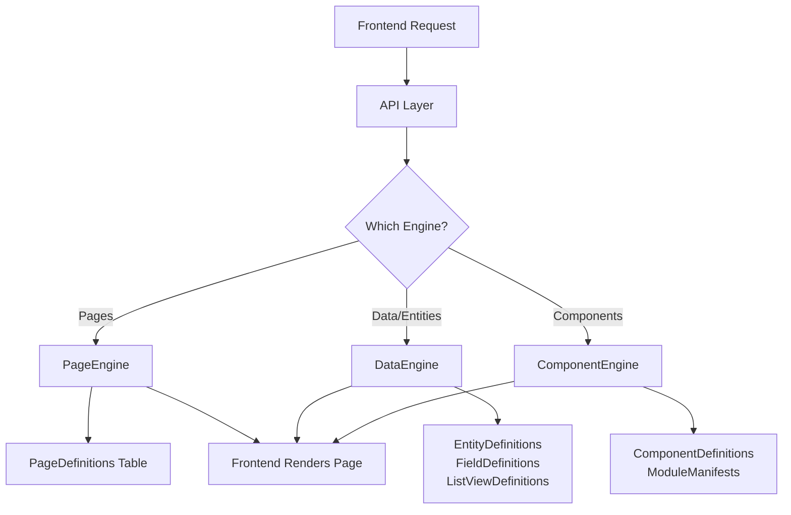
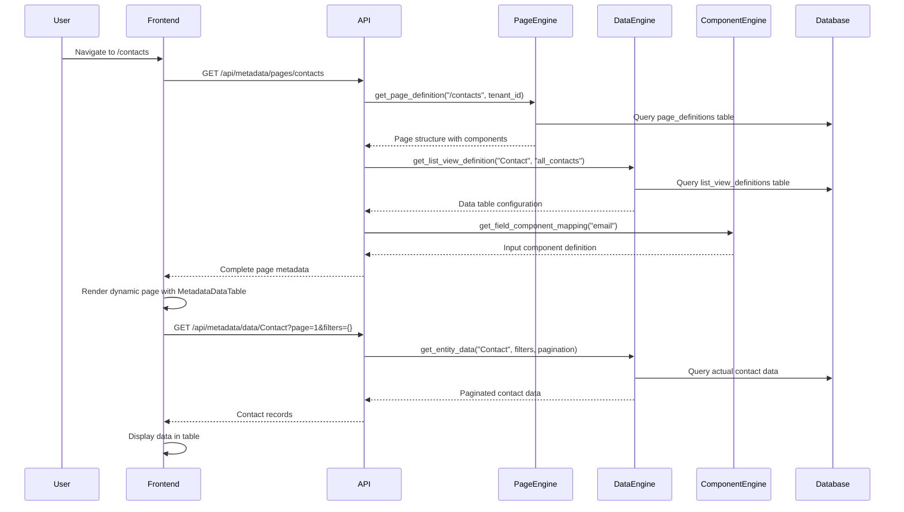

Excellent question! These three engines are the **core metadata processors** of your platform. They form the foundation of your metadata-driven architecture. Let me explain how each one works and how they work together.

## 🏗️ **Architecture Overview**

These engines implement the **Engine Pattern** - each engine is responsible for managing and serving specific types of metadata:



---

## 🧩 **ComponentEngine** - Component Catalog Manager

**Purpose:** Manages the platform's component library and module system.

### **Key Responsibilities:**

- **Component Discovery** - Find UI components by name/type/category
- **Module Management** - Handle WordPress-style plugin modules
- **Field Mapping** - Map data types to appropriate UI components
- **Dependency Resolution** - Manage component dependencies

### **How It Works:**

```python
# Example: Get component for a field type
component = await component_engine.get_field_component_mapping("email")
# Returns: {"name": "Input", "type": "fieldControl", "module": "core"}

# Example: List all form components
components = await component_engine.list_components_by_category(
    category="fieldControl"
)
```

### **Field-to-Component Mappings:**

```python
field_mappings = {
    "string": {"name": "Input", "module": "core"},
    "email": {"name": "Input", "module": "core"},
    "boolean": {"name": "Checkbox", "module": "core"},
    "date": {"name": "DatePicker", "module": "core"},
    "afm": {"name": "AFMInput", "module": "greek"},  # Greek business
    "picklist": {"name": "Select", "module": "core"}
}
```

---

## 📊 **DataEngine** - Business Logic & Data Manager

**Purpose:** Manages business entities, fields, and data operations with tenant isolation.

### **Key Responsibilities:**

- **Entity Management** - Define business objects (Contact, Invoice, etc.)
- **Field Definitions** - Configure field types, validation, behavior
- **List Views** - Define how data tables should render and behave
- **Data Retrieval** - Paginated, filtered, sorted data access
- **Tenant Isolation** - Separate data per company

### **How It Works:**

```python
# Get entity with all fields and validation rules
entity = await data_engine.get_entity_with_fields("Contact", tenant_id)

# Get list view configuration for data tables
list_view = await data_engine.get_list_view_definition(
    "Contact", "all_contacts", tenant_id
)

# Get paginated data with filtering
data = await data_engine.get_entity_data(
    entity_name="Contact",
    page=1,
    page_size=25,
    search="john",
    filters={"status": "active"},
    sort_field="created_at",
    sort_order="DESC"
)
```

### **Tenant Override System:**

The DataEngine implements **tenant inheritance** - tenant-specific definitions override global ones:

```python
# Query Priority:
# 1. Tenant-specific definition (tenant_id = 'company-123')
# 2. Global definition (tenant_id = NULL)

query = select(EntityDefinition).where(
    and_(
        EntityDefinition.entity_name == "Contact",
        or_(
            EntityDefinition.tenant_id == tenant_id,    # Tenant-specific
            EntityDefinition.tenant_id.is_(None)        # Global fallback
        )
    )
).order_by(
    EntityDefinition.tenant_id.desc().nulls_last()  # Tenant first
)
```

---

## 🎭 **PageEngine** - Dynamic Page Manager

**Purpose:** Manages page structures and component composition for runtime page generation.

### **Key Responsibilities:**

- **Page Definitions** - Store page structure and routing
- **Component Composition** - Define which components appear on each page
- **Access Control** - Role-based page access
- **Tenant Customization** - Company-specific page layouts

### **How It Works:**

```python
# Get page definition by route
page = await page_engine.get_page_definition("/contacts", tenant_id)

# Check if user can access page
has_access = await page_engine.validate_page_access(
    route="/admin/settings",
    user_roles=["admin", "manager"],
    tenant_id=tenant_id
)

# Get all components for a page
components = await page_engine.get_page_components("/dashboard", tenant_id)
```

### **Page Structure Example:**

```json
{
  "page_name": "contacts_list",
  "route": "/contacts",
  "components": [
    {
      "type": "MetadataDataTable",
      "props": {
        "entityName": "Contact",
        "viewName": "all_contacts"
      }
    },
    {
      "type": "Button",
      "props": {
        "label": "New Contact",
        "route": "/contacts/new"
      },
      "position": { "x": "top-4", "y": "right-4" }
    }
  ]
}
```

---

## 🔄 **How They Work Together**

Here's a **real-world example** of how all three engines collaborate:

### **Scenario: User visits `/contacts` page**



### **Step-by-Step Flow:**

1. **PageEngine** provides page structure:

   ```json
   {
     "route": "/contacts",
     "components": [
       { "type": "MetadataDataTable", "props": { "entityName": "Contact" } }
     ]
   }
   ```

2. **DataEngine** provides data table configuration:

   ```json
   {
     "view_name": "all_contacts",
     "columns": [
       { "field": "name", "sortable": true, "filterable": true },
       { "field": "email", "data_type": "email" }
     ],
     "pagination_enabled": true,
     "search_enabled": true
   }
   ```

3. **ComponentEngine** provides field components:

   ```json
   {
     "email": { "name": "Input", "type": "fieldControl" },
     "status": { "name": "Select", "type": "fieldControl" }
   }
   ```

4. **Frontend** combines all metadata to render the page dynamically.

---

## 🎯 **Key Benefits of This Architecture**

### **1. Complete Separation of Concerns**

- **PageEngine** → Page structure and navigation
- **DataEngine** → Business logic and data management
- **ComponentEngine** → UI components and field mappings

### **2. Tenant Isolation**

Every engine supports tenant-specific overrides:

```python
# Each engine checks tenant_id priority:
# 1. Tenant-specific (tenant_id = 'company-123')
# 2. Global fallback (tenant_id = NULL)
```

### **3. Runtime Flexibility**

No hardcoded UI - everything generated from database metadata:

```typescript
// Frontend just renders from metadata
const DynamicPage = ({ pageDefinition, entityData, componentMappings }) => {
  return <MetadataRenderer metadata={pageDefinition} />;
};
```

### **4. Vertical Customization**

Each industry vertical can have different:

- **Page layouts** (PageEngine)
- **Entity structures** (DataEngine)
- **Component libraries** (ComponentEngine)

### **5. WordPress-Style Extensibility**

- **Modules** define new components
- **Manifests** manage dependencies
- **Component catalog** supports marketplace

---

## 🚀 **Real-World Use Cases**

### **E-commerce Vertical:**

```python
# PageEngine: Product catalog pages
# DataEngine: Product entities with inventory fields
# ComponentEngine: E-commerce specific components (PriceInput, StockLevel)
```

### **Automotive Vertical:**

```python
# PageEngine: Vehicle inventory pages
# DataEngine: Vehicle entities with VIN, make/model fields
# ComponentEngine: Automotive components (VINInput, MakeSelector)
```

### **Greek Business Compliance:**

```python
# ComponentEngine provides Greek-specific components:
await component_engine.get_field_component_mapping("afm")
# Returns: AFMInput component for Greek tax numbers
```

This architecture makes your platform incredibly powerful because **everything is configurable through metadata** while maintaining clean separation between page structure, business logic, and UI components!
